# DistriRAG: A Fault-Tolerant Distributed Retrieval Pipeline for Hospital Knowledge

**CMPE 272: Enterprise Software Platforms · Master's Final Project · San José State University · Fall 2026**

**Team CTRL-ALT-DEL:** Manoj Ganjigatte Manjunatha · Prajval Sudhir · Vinayak Gupta

**Live deployment:** http://35.184.233.38 (Google Cloud, continuously deployed from `main`)

---

## Abstract

Hospital staff need the *current, approved* version of a policy within seconds, and an assistant that answers from it
must never invent, diagnose or leak patient data. DistriRAG is a distributed retrieval-augmented generation (RAG)
system built around that requirement. Documents move through an approval workflow and a **transactional-outbox →
Redis Streams → worker pool** pipeline into PostgreSQL with pgvector. A version becomes searchable only once every
chunk is embedded, and it replaces its predecessor atomically. The pipeline survives worker crashes, relay crashes,
broker restarts and broker data loss with **zero lost documents and zero duplicate vectors**, which we verify with
fault-injection tests that SIGKILL real processes. A rules-first guardrail layer screens questions for protected
health information (PHI), refuses diagnoses and patient-specific orders, verifies every citation, and records an
auditable receipt for each answer. The full stack runs in about **106 MiB of RAM** on a laptop and deploys to GCP
through a keyless CI/CD pipeline.

All documents in this repository are **synthetic**. DistriRAG is a reference tool: it does not diagnose patients,
recommend treatment, or replace clinical judgement.

## Goals

1. **Trustworthy retrieval.** Staff only ever see the current, approved version of a policy they are allowed to read,
   and every assistant claim cites its source.
2. **Reliable, distributed ingestion.** No document is lost or duplicated when any process, the broker, or the network
   fails partway through indexing.
3. **Safe AI assistance.** Patient identifiers never reach a model, diagnoses and patient-specific orders are refused,
   emergencies are escalated first, and every answer leaves an audit trail.
4. **Deployable anywhere.** The same image runs on a laptop, in an air-gapped hospital, or in the cloud, and ships to
   production automatically on every merge.

## Problem and motivation

- **Stale or unapproved answers are dangerous.** Search has to respect approval state, versions and access rights
  inside the query itself, not as a post-filter.
- **Ingestion must not lose or duplicate work.** A crashed worker, a broker restart or a duplicate delivery must
  neither drop a document nor create duplicate vectors that skew retrieval.
- **LLMs need guardrails a compliance officer can audit.** Every refusal, redaction and outbound model call should be
  explainable after the fact.
- **Hospitals have weak hardware and air-gapped networks.** The system has to run without a GPU, without model
  downloads, and without internet access.

## Methodology

1. **Requirements first.** We wrote the proposal ([docs/PROPOSAL.md](docs/PROPOSAL.md)) as numbered requirements
   (RL-*, CP-*, AG-*, TS-*) with *Must/Should* priorities and 24 acceptance scenarios (AT-01…AT-24) before coding.
2. **Design for failure.** Postgres is the single source of truth and Redis Streams only carries work, so any message
   can be replayed. Every stage is idempotent, and nothing is acknowledged before its database transaction commits.
3. **Ports and adapters.** Business rules are pure functions. I/O (database, broker, blob storage, LLM, embedder) sits
   behind small interfaces, so providers can be swapped per deployment profile. A unit test enforces the boundary.
4. **Test-driven increments.** Work was split into epics E0–E14. Each test names the requirement IDs it covers, and a
   coverage matrix fails CI if any *Must* requirement has no test.
5. **Measure, don't assume.** Fault injection kills real worker processes and wipes Redis mid-run. An 85-case guardrail
   evaluation and a 60-turn persona UX corpus gate releases. Relevance thresholds come from a calibration script, not
   guesswork.
6. **Automate delivery.** GitHub Actions runs lint, types, unit, integration, regression, web and audit jobs on every
   push. A second workflow builds, publishes and rolls out the image to GCP with keyless authentication.

### Distributed-systems contributions

| Concern | Technique used in DistriRAG |
| --- | --- |
| Atomic state change + message publish | **Transactional outbox**: the state change and the outbox row share one Postgres transaction; a relay copies rows to Redis with `XADD` |
| Work distribution | **Redis Streams consumer groups** (`ingest.extract`, `ingest.embed`, `ingest.finalize`, `docs.delete`) with competing consumers |
| At-least-once delivery, exactly-once effect | **ACK after commit**, deterministic chunk ids (`uuid5(version, index)`), upserts and `Idempotency-Key` on uploads |
| Failure detection and recovery | Pending-entry reclaim (`XCLAIM`) with exponential backoff, **dead-letter streams** after 5 deliveries, re-drive of stuck versions from Postgres as the source of truth |
| Consistent reads during writes | A version is published only when every chunk has a vector; one transaction supersedes the old version and clears dependent caches |
| Concurrency control | Row locks on documents during finalization; separation of duties (the uploader can never approve) |
| Deployment flexibility | One image, four roles (`api`, `relay`, `worker`, `recovery`), run as one process (`lite`) or as separate containers (`full`) |

## Architecture


**Document flow:** upload → approval by a different person → outbox → relay → extract and chunk → embed in batches of
16 → finalize (atomic version swap) → searchable.
**Question flow:** PHI screen → rules-first classifier → emergency banner → permission-filtered hybrid retrieval →
refusal of diagnoses and orders → egress policy → generation → redaction → citation verification → confidence score
→ audited receipt.
Details: [docs/ARCHITECTURE.md](docs/ARCHITECTURE.md).

## Outcomes

**Delivered:** a working, deployed product. It has an approval workflow with separation of duties, a fault-tolerant
ingestion pipeline, permission-aware hybrid search with version history, a guarded clinical-reference assistant with
citations, confidence scores and receipts, renameable conversation history, an admin analytics dashboard, a compliance
console (approvals, audit log, egress, deletions), a live pipeline board with recovery drills, runtime model settings,
and continuous deployment to Google Cloud.

**Measured** on the `lite` profile (hashing embedder, fake LLM, 24 synthetic documents plus 4 second versions). Full
numbers and method: [docs/RESULTS.md](docs/RESULTS.md).

| Area | Result |
| --- | --- |
| Memory footprint (app + Postgres + Redis) | **105.8 MiB** total; runtime image 322 MB, no PyTorch |
| Ingestion | 24 documents approved and READY in 6.6 s on the GCP deployment |
| Fault injection (17 scenarios × 3 runs) | 17/17 each run: worker SIGKILL mid-batch, relay crash after `XADD`, Redis restart, Redis data loss, duplicate delivery; **0 lost documents, 0 duplicate vectors** |
| Guardrail eval (85 cases) | 0 unsafe outputs, 0 permission leaks, 0 PHI leaks; classification 1.000; citation validity 1.000; retrieval hit@5 1.000 |
| Requirement coverage | 68/68 *Must* requirements mapped to tests (`make coverage-matrix`) |

## Relevance to enterprise technology

DistriRAG applies the patterns that enterprise platforms depend on to a regulated domain:

| Enterprise concern | How DistriRAG addresses it |
| --- | --- |
| **Reliable integration between services** | Transactional outbox and consumer groups, the standard answer to the dual-write problem in event-driven microservices |
| **Governance and compliance (HIPAA-style)** | Role-based access enforced in SQL, separation of duties, PHI redaction or blocking, an append-only audit log, retention windows, and egress control by document classification |
| **Responsible enterprise AI** | Retrieval grounded only in approved content, rules-first guardrails a compliance officer can read (`assistant/rules.yaml`), citation verification, and a receipt for every answer |
| **Vendor and model independence** | Pluggable LLM providers (OpenRouter, an OpenAI-compatible proxy, local Ollama, none) and storage (local, S3, Azure Blob), switchable at runtime without a redeploy |
| **Hybrid and sovereign deployment** | One image for laptop, air-gapped, hybrid and cloud profiles; nothing leaves the network in air-gapped mode |
| **DevSecOps** | CI quality gates, dependency audits, an API contract snapshot, secrets kept in GitHub secrets, Workload Identity Federation (no long-lived cloud keys) and commit-tagged images for rollback |
| **Observability and operations** | Prometheus metrics, structured JSON logs, readiness checks, dead-letter replay and recovery drills in the UI |
| **Cost efficiency** | About 106 MiB of RAM for the full stack, and a single `e2-medium` VM (about $25–30 per month) in production |

## Live demo

Open **http://35.184.233.38** and choose a demo card. Every account is fictional.

| Account | Role | Try this |
| --- | --- | --- |
| Alex Morgan | Document admin | Library → New document: upload a policy, compare versions, view analytics |
| Taylor Brooks | Compliance | Approve or reject Alex's upload; browse the audit log |
| Sam Lee | Nurse | Search "how long should I rub hands with alcohol"; ask the assistant |
| Dr. Priya Rao | Physician | "What are our sepsis screening criteria?" (cited, with a confidence score and receipt) |
| Jordan Kim | Pharmacist | Medication policies; dose questions are routed to pharmacy, not answered |
| Riley Chen | General staff | Search "controlled substance waste" and get nothing: access rules are applied inside the query |
| Casey Diaz | Operations | Pipeline board: kill a worker and watch the reclaim, with 0 duplicates and 0 lost |

The 12-minute presentation script is in [docs/DEMO.md](docs/DEMO.md).

The deployment is pre-loaded for a leadership demo. It has 24 approved policies, two drafts waiting in Taylor's
approval queue (`make seed-review`), and titled, multi-turn conversations for every clinical and front-desk persona
(`make seed-chats`, from [corpus/demo_chats.yaml](corpus/demo_chats.yaml)). The conversations include real cited
answers, such as ED sepsis escalation, stroke last-known-well, a night-shift fall and C. difficile isolation. They also
include one deliberate showcase per guardrail: diagnosis refused, patient identifiers blocked, the emergency banner,
access control, and a confidential policy kept inside the hospital.

## Setup instructions

### Prerequisites

- Docker Desktop, OrbStack or Docker Engine with Compose v2, with at least 2 GB of RAM for Docker
- `make` and `git`. Python, Node, Postgres and Redis are **not** needed on the host, because everything runs in containers.

### 1. Clone and configure

```bash
git clone https://github.com/mgm152002/Hospital_DistriRAG_CMPE_272.git && cd Hospital_DistriRAG_CMPE_272
cp .env.example .env
```

`.env` is git-ignored. The defaults (`DEPLOYMENT_PROFILE=lite`, no LLM) run with no keys and no downloads. To get
generated answers, add an AI provider:

```bash
# .env: OpenRouter's free models (create a key at openrouter.ai)
LLM_PROVIDER=openrouter-free
OPENROUTER_API_KEY=sk-or-...
OPENROUTER_MODEL=openrouter/free
ALLOWED_HOSTS=["postgres","redis","localhost","openrouter.ai"]
```

Every setting is documented in [.env.example](.env.example). `PHI_MODE=block` (the default) refuses questions that
contain patient identifiers. `PHI_MODE=redact` removes them and still answers.

### 2. Start the stack and load the demo data

```bash
make up            # postgres + redis + one app process (lite profile)
make seed          # upload, approve and index the 24 synthetic hospital policies
make seed-review   # optional: two drafts left pending approval
make seed-chats    # optional: titled demo conversations (needs an LLM provider; retries on rate limits)
open http://localhost:8000
```

Port 8000 busy? Set `PORT=8080` in `.env`, run `make up`, then use `API_URL=http://host.docker.internal:8080` with the
seed targets.

### 3. Verify

```bash
curl -s localhost:8000/readyz        # {"ready":true,"postgres":true,"redis":true}
make test && make test-integration   # see "Testing and CI" for every suite
```

### Profiles

| Profile | Answers from | Embeddings | Use it for |
| --- | --- | --- | --- |
| `lite` (default) | none (passages only) or `LLM_PROVIDER=fake` | hashing, no download | laptops, CI, demos |
| `airgapped` | local Ollama | MiniLM (ONNX, baked into the image) | no network at all |
| `hybrid` | external API, behind the egress policy | MiniLM | a small cloud VM |
| `cloud` | managed API | MiniLM | managed database and storage |

`make up-full` runs the API, relay, two workers and recovery as separate containers. `make up-airgapped` adds a local
model. An administrator can switch AI providers and models at runtime under **Settings**.

## Functional tests

[`web/e2e/functional.spec.ts`](web/e2e/functional.spec.ts) drives a real Chromium browser through the twelve
behaviours a hospital evaluator cares about, against the live deployment, and saves a screenshot for each one. It
cleans up everything it creates.

```bash
make test-functional BASE_URL=http://35.184.233.38   # or any running, seeded stack
```

**Latest run:** 12/12 passed in 18.8 s against the live GCP deployment (Chromium, 2026-11-26).

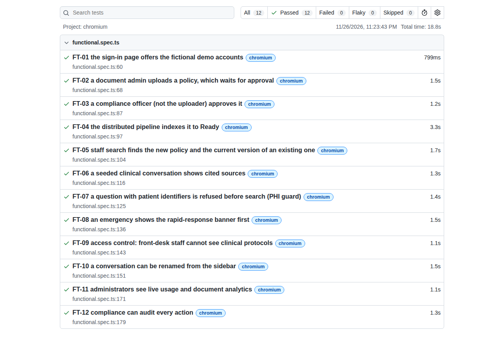

| ID | Behaviour verified | Result | Screenshot |
| --- | --- | --- | --- |
| FT-01 | Sign-in page offers the fictional demo accounts | ✅ Passed | [view](docs/screenshots/functional/FT-01-sign-in.png) |
| FT-02 | A document admin uploads a policy; it waits for approval | ✅ Passed | [view](docs/screenshots/functional/FT-02-upload-pending.png) |
| FT-03 | A compliance officer (not the uploader) approves it | ✅ Passed | [view](docs/screenshots/functional/FT-03-approval-queue.png) |
| FT-04 | The distributed pipeline (outbox → Redis Streams → workers) indexes it to Ready | ✅ Passed | [view](docs/screenshots/functional/FT-04-pipeline-ready.png) |
| FT-05 | Search finds the new policy and the current version of an existing one, with version history | ✅ Passed | [view](docs/screenshots/functional/FT-05-search.png) |
| FT-06 | A clinical conversation shows a cited, source-grounded answer | ✅ Passed | [view](docs/screenshots/functional/FT-06-cited-conversation.png) |
| FT-07 | A question with patient identifiers is refused before search, and stored redacted | ✅ Passed | [view](docs/screenshots/functional/FT-07-phi-blocked.png) |
| FT-08 | An emergency shows the rapid-response banner first | ✅ Passed | [view](docs/screenshots/functional/FT-08-emergency-banner.png) |
| FT-09 | Front-desk staff cannot see clinical protocols (access control in SQL) | ✅ Passed | [view](docs/screenshots/functional/FT-09-access-control.png) |
| FT-10 | A conversation can be renamed from the sidebar | ✅ Passed | [view](docs/screenshots/functional/FT-10-rename-conversation.png) |
| FT-11 | Administrators see live usage and document analytics | ✅ Passed | [view](docs/screenshots/functional/FT-11-admin-analytics.png) |
| FT-12 | Compliance can audit every action | ✅ Passed | [view](docs/screenshots/functional/FT-12-audit-log.png) |

<details>
<summary><strong>All functional-test screenshots</strong></summary>

**FT-01: Sign-in page offers the fictional demo accounts**

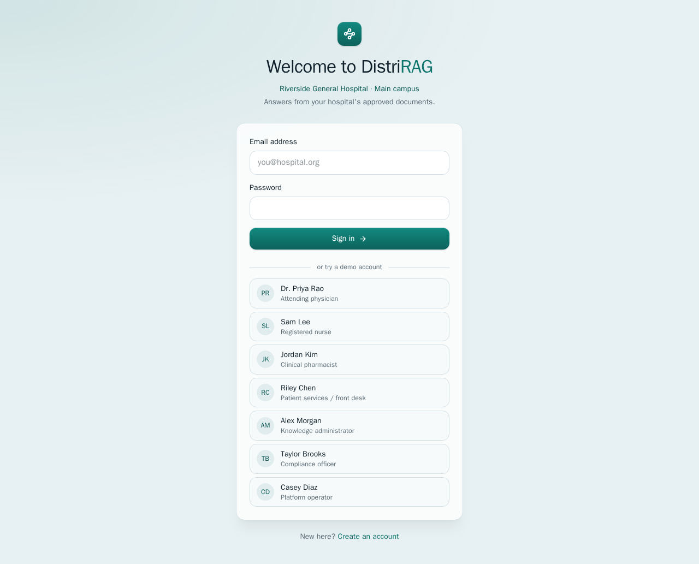

**FT-02: A document admin uploads a policy; it waits for approval**

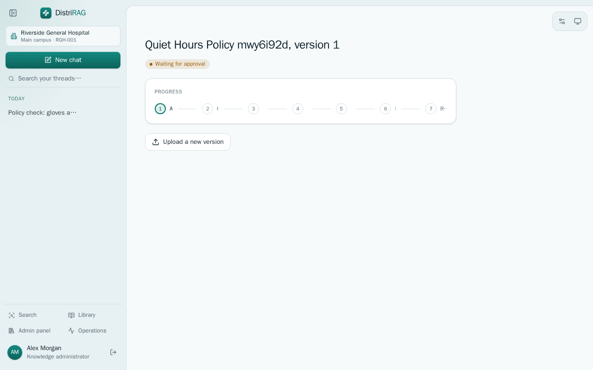

**FT-03: A compliance officer (not the uploader) approves it**

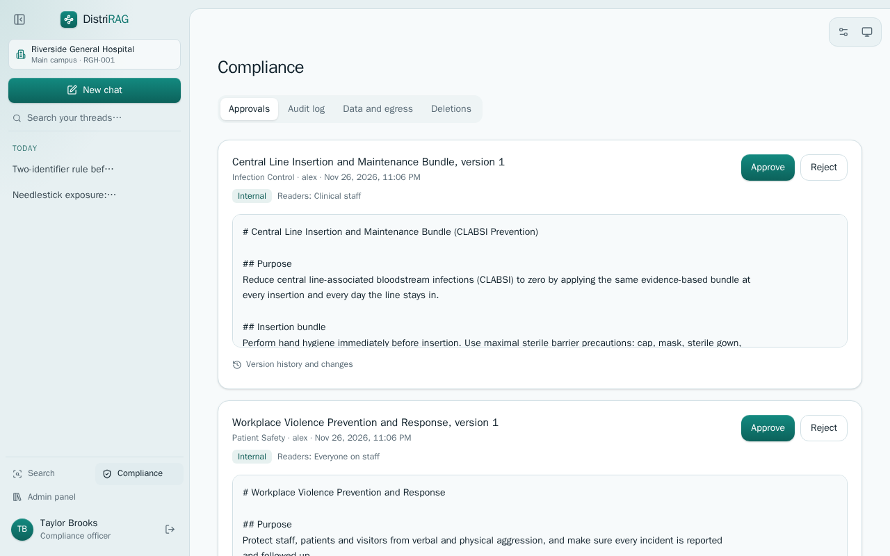

**FT-04: The distributed pipeline (outbox → Redis Streams → workers) indexes it to Ready**

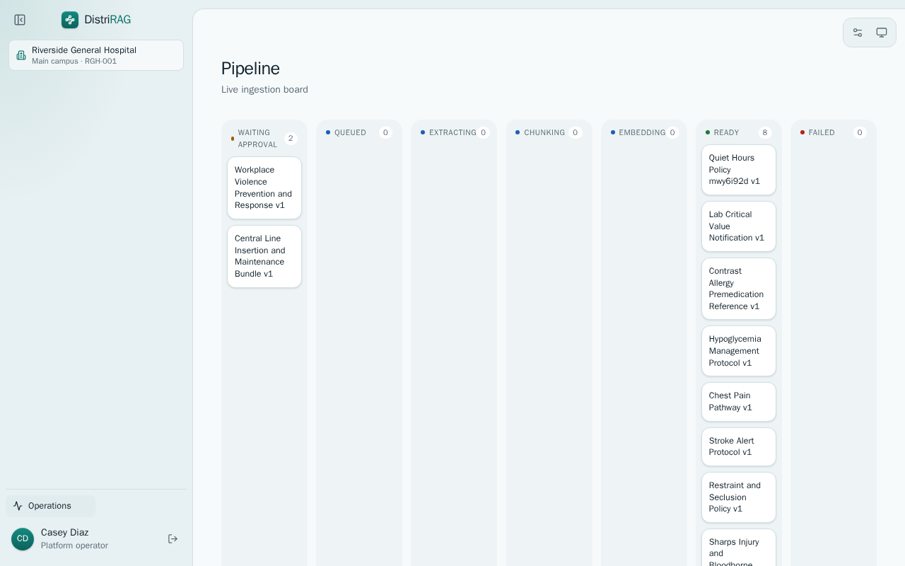

**FT-05: Search finds the new policy and the current version of an existing one, with version history**

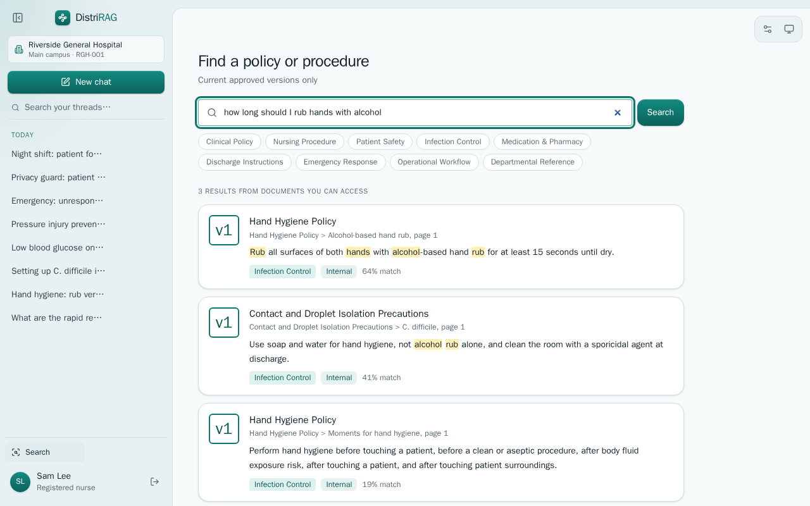

**FT-06: A clinical conversation shows a cited, source-grounded answer**

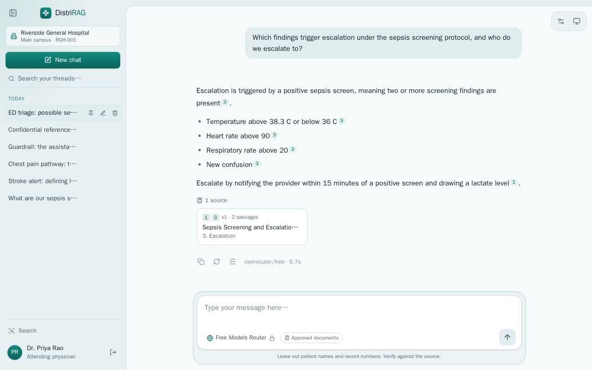

**FT-07: A question with patient identifiers is refused before search, and stored redacted**

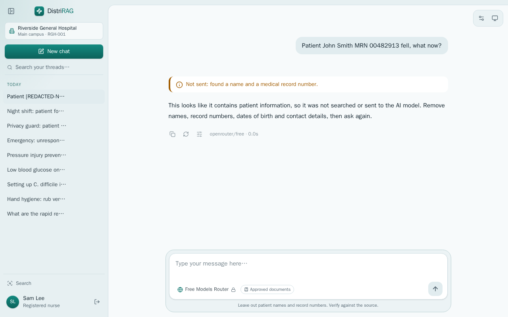

**FT-08: An emergency shows the rapid-response banner first**

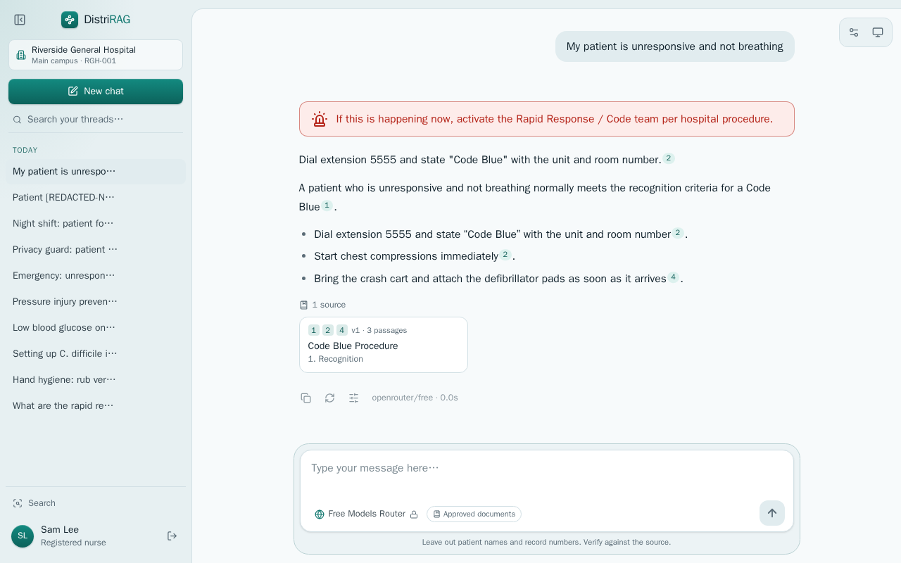

**FT-09: Front-desk staff cannot see clinical protocols (access control in SQL)**

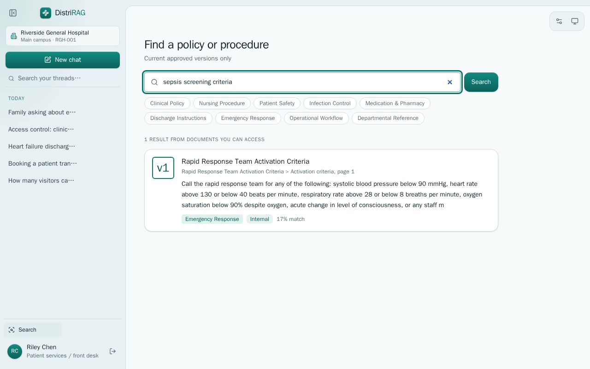

**FT-10: A conversation can be renamed from the sidebar**

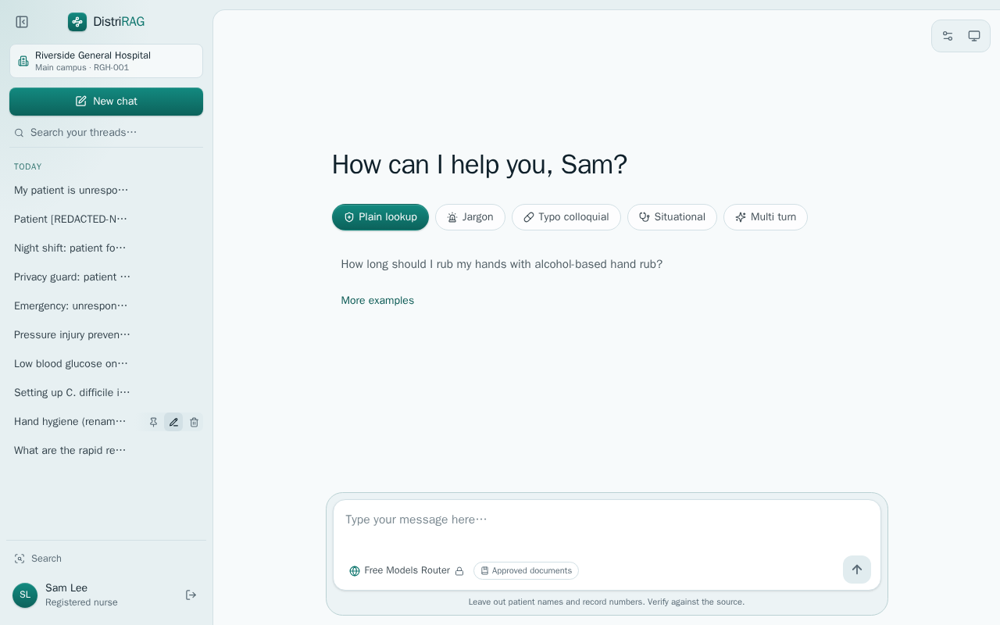

**FT-11: Administrators see live usage and document analytics**

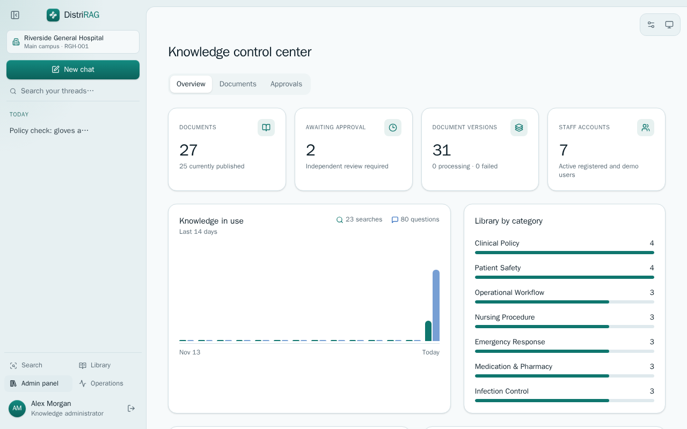

**FT-12: Compliance can audit every action**

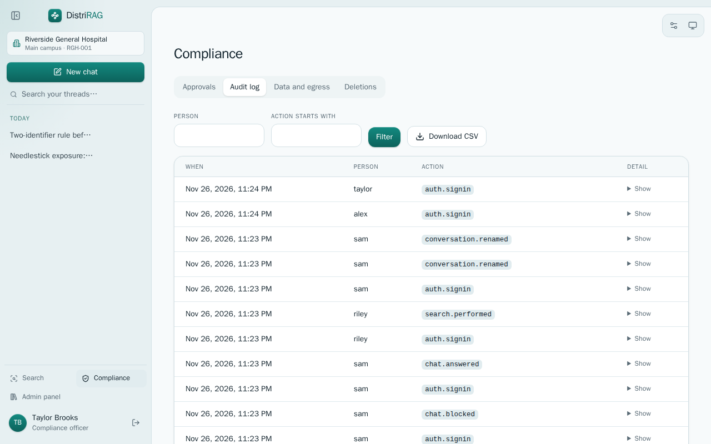

</details>

## Testing and CI

| Suite | Command | Count |
| --- | --- | --- |
| Lint and types (ruff, mypy) | `make lint` | 87 source files |
| Unit | `make test` | 412 tests |
| Integration (real Postgres, Redis, S3 and Azure emulators, fault injection) | `make test-integration` | 156 tests |
| Regression (24 acceptance scenarios, API contract snapshot, eval gates) | `make regression` | 36 tests |
| Frontend (Vitest) | `make test-web` | 96 tests |
| Functional (Playwright, real browser, screenshots) | `make test-functional` | 12 tests (FT-01…FT-12) |
| End-to-end (Playwright, nightly) | `make test-e2e` | demo storyline |

GitHub Actions runs every suite on each push, together with dependency audits (`pip-audit`, `npm audit`) and image
builds. Fresh results are recorded in [docs/VERIFICATION.md](docs/VERIFICATION.md).

## Deployment (GCP)

Every push to `main` triggers [`deploy-gcp.yml`](.github/workflows/deploy-gcp.yml). It builds the image, pushes it to
Artifact Registry tagged with the commit SHA, creates the Compute Engine VM on the first run, rolls the new image out
over OS Login, and smoke-tests `/readyz` on the public IP. GitHub authenticates through **Workload Identity
Federation**, so no service-account key exists. App settings come from the `APP_ENV` repository secret. Setup and
rollback: [deploy/gcp/README.md](deploy/gcp/README.md).

## Engineering practices

- **Clean boundaries:** ports-and-adapters layering, with pure business rules enforced by
  `tests/unit/test_architecture.py`, and one responsibility per module (`pipeline/stages/*`, `assistant/*`).
- **Typed and linted:** Python type hints checked by mypy and style by ruff (120 columns); strict TypeScript in the
  frontend.
- **Documented code:** module and function docstrings explain *why*, and comments mark non-obvious invariants
  (ACK-after-commit, idempotency keys, lock ordering). Every test file names the requirements it covers.
- **Secure by default:** secrets only in git-ignored `.env` or GitHub secrets; scrypt password hashing; HttpOnly,
  SameSite cookies; Origin checks on mutations; egress allow-list; dependency audits in CI.
- **Reproducible:** one Dockerfile and Compose for every environment; migrations applied automatically on start;
  images tagged with the commit SHA.
- **Reviewable change:** small commits per epic, an API contract snapshot that changes only on purpose, and CI that must
  pass before deploy.

## Repository layout

| Folder | Holds |
| --- | --- |
| `api/` | FastAPI app, routes, local and OIDC authentication |
| `documents/` | Intake, approval and read models |
| `pipeline/` | Outbox, relay, stream consumers, ingestion stages, recovery, drills |
| `search/` | Hybrid vector and lexical search, clinical abbreviation expansion |
| `assistant/` | Guardrails, PHI screening, prompt, citations, confidence, chat pipeline |
| `common/` | Configuration profiles, database, providers (blob, embedding, LLM), egress guard, metrics |
| `web/` | React + TypeScript frontend |
| `corpus/`, `evals/`, `tests/` | Synthetic documents, evaluation sets, test suites |
| `deploy/` | SQL migrations, Compose files, VM and GCP deployment |

## Documentation

| Document | Covers |
| --- | --- |
| [docs/PROPOSAL.md](docs/PROPOSAL.md) | Project proposal: requirements, epics and acceptance tests |
| [docs/ARCHITECTURE.md](docs/ARCHITECTURE.md) | Components, document and question flows, deployment profiles |
| [docs/DECISIONS.md](docs/DECISIONS.md) | Design decisions and the alternatives we rejected |
| [docs/RESULTS.md](docs/RESULTS.md) | Measured footprint, relevance calibration, eval and fault-injection results |
| [docs/VERIFICATION.md](docs/VERIFICATION.md) | Latest test, CI and deployment evidence, and known gaps |
| [docs/SECURITY.md](docs/SECURITY.md) | OWASP Top 10 for LLM applications, mapped to controls |
| [docs/COMPLIANCE.md](docs/COMPLIANCE.md) | Data flows, HIPAA safeguards, and what real PHI would require |
| [docs/DEMO.md](docs/DEMO.md) | The 12-minute demo script and fallbacks |
| [docs/DEVELOPMENT.md](docs/DEVELOPMENT.md) | Developer setup, test commands, folder map |
| [evals/ux/README.md](evals/ux/README.md) | Persona × scenario UX evaluation corpus and run logs |
| [deploy/gcp/README.md](deploy/gcp/README.md) | Continuous deployment to Google Cloud |
| [deploy/cloud/README.md](deploy/cloud/README.md) | Manual single-VM deployment with HTTPS (Caddy) |

## Limitations and future work

- Browser SSO is partial: OIDC tokens are validated by the API, but the full redirect flow is unfinished. Local
  accounts have no email verification or password recovery.
- The application and retention database roles are not yet separated.
- Embeddings run locally (hashing or MiniLM). Hosted embedding adapters are future work.
- The live deployment is a single VM over plain HTTP. HTTPS is one variable away (`GCP_DOMAIN`), and managed Postgres
  and Redis would remove the single point of failure.

The full list is in [docs/VERIFICATION.md](docs/VERIFICATION.md).

## License and data

Academic project by team CTRL-ALT-DEL for CMPE 272 at San José State University. All hospital documents, personas and patients in this
repository are fictional.
