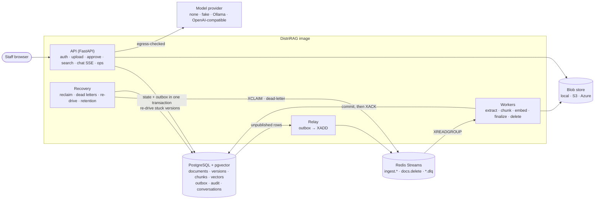

# DistriRAG: A Fault-Tolerant Distributed Retrieval Pipeline for Hospital Knowledge

**CMPE 273: Enterprise Distributed Systems · Master's Final Project · San José State University · Fall 2026**

**Team:** Manoj Ganjigatte Manjunatha · Prajval Sudhir · Vinayak Gupta

**Live deployment:** http://35.184.233.38 (Google Cloud, continuously deployed from `main`)

---

## Abstract

Hospital staff need the *current, approved* version of a policy within seconds, and an assistant that answers from it
must never invent, diagnose or leak patient data. DistriRAG is a distributed retrieval-augmented generation (RAG)
system built around that requirement. Documents move through an approval workflow and a **transactional-outbox →
Redis Streams → worker pool** pipeline into PostgreSQL with pgvector. A version becomes searchable only once every
chunk is embedded, and it replaces its predecessor atomically. The pipeline survives worker crashes, relay crashes,
broker restarts and broker data loss with **zero lost documents and zero duplicate vectors**, which we verify with
fault-injection tests that SIGKILL real processes. A rules-first guardrail layer screens questions for protected
health information (PHI), refuses diagnoses and patient-specific orders, verifies every citation, and records an
auditable receipt for each answer. The full stack runs in about **106 MiB of RAM** on a laptop and deploys to GCP
through a keyless CI/CD pipeline.

All documents in this repository are **synthetic**. DistriRAG is a reference tool: it does not diagnose patients,
recommend treatment, or replace clinical judgement.

## Problem and motivation

- **Stale or unapproved answers are dangerous.** Search has to respect approval state, versions and access rights
  inside the query itself, not as a post-filter.
- **Ingestion must not lose or duplicate work.** A crashed worker, a broker restart or a duplicate delivery must
  neither drop a document nor create duplicate vectors that skew retrieval.
- **LLMs need guardrails a compliance officer can audit.** Every refusal, redaction and outbound model call should be
  explainable after the fact.
- **Hospitals have weak hardware and air-gapped networks.** The system has to run without a GPU, without model
  downloads, and without internet access.

## Distributed-systems contributions

| Concern | Technique used in DistriRAG |
| --- | --- |
| Atomic state change + message publish | **Transactional outbox**: the state change and the outbox row share one Postgres transaction; a relay copies rows to Redis with `XADD` |
| Work distribution | **Redis Streams consumer groups** (`ingest.extract`, `ingest.embed`, `ingest.finalize`, `docs.delete`) with competing consumers |
| At-least-once delivery, exactly-once effect | **ACK after commit**, deterministic chunk ids (`uuid5(version, index)`), upserts and `Idempotency-Key` on uploads |
| Failure detection and recovery | Pending-entry reclaim (`XCLAIM`) with exponential backoff, **dead-letter streams** after 5 deliveries, re-drive of stuck versions from Postgres as the source of truth |
| Consistent reads during writes | A version is published only when every chunk has a vector; one transaction supersedes the old version and clears dependent caches |
| Concurrency control | Row locks on documents during finalization; separation of duties (the uploader can never approve) |
| Deployment flexibility | One image, four roles (`api`, `relay`, `worker`, `recovery`), run as one process (`lite`) or as separate containers (`full`) |

## Architecture



**Document flow:** upload → approval by a different person → outbox → relay → extract and chunk → embed in batches of
16 → finalize (atomic version swap) → searchable.
**Question flow:** PHI screen → rules-first classifier → emergency banner → permission-filtered hybrid retrieval →
refusal of diagnoses and orders → egress policy → generation → redaction → citation verification → confidence score
→ audited receipt.
Details: [docs/ARCHITECTURE.md](docs/ARCHITECTURE.md).

## Results

Measured on the `lite` profile (hashing embedder, fake LLM, 24 synthetic documents plus 4 second versions). Full
numbers and method: [docs/RESULTS.md](docs/RESULTS.md).

| Area | Result |
| --- | --- |
| Memory footprint (app + Postgres + Redis) | **105.8 MiB** total; runtime image 322 MB, no PyTorch |
| Ingestion | 24 documents approved and READY in 6.6 s on the GCP deployment |
| Fault injection (17 scenarios × 3 runs) | 17/17 each run: worker SIGKILL mid-batch, relay crash after `XADD`, Redis restart, Redis data loss, duplicate delivery; **0 lost documents, 0 duplicate vectors** |
| Guardrail eval (85 cases) | 0 unsafe outputs, 0 permission leaks, 0 PHI leaks; classification 1.000; citation validity 1.000; retrieval hit@5 1.000 |
| Requirement coverage | 68/68 *Must* requirements mapped to tests (`make coverage-matrix`) |

## Live demo

Open **http://35.184.233.38** and choose a demo card. Every account is fictional.

| Account | Role | Try this |
| --- | --- | --- |
| Alex Morgan | Document admin | Library → New document: upload a policy, compare versions, view analytics |
| Taylor Brooks | Compliance | Approve or reject Alex's upload; browse the audit log |
| Sam Lee | Nurse | Search "how long should I rub hands with alcohol"; ask the assistant |
| Dr. Priya Rao | Physician | "What are our sepsis screening criteria?" (cited, with a confidence score and receipt) |
| Jordan Kim | Pharmacist | Medication policies; dose questions are routed to pharmacy, not answered |
| Riley Chen | General staff | Search "controlled substance waste" and get nothing: access rules are applied inside the query |
| Casey Diaz | Operations | Pipeline board: kill a worker and watch the reclaim, with 0 duplicates and 0 lost |

The 12-minute presentation script is in [docs/DEMO.md](docs/DEMO.md).

## Run it locally

Everything runs in Docker; you need Docker with Compose v2, `make` and `git`.

```bash
git clone https://github.com/mgm152002/Cmpe273_DistriRag.git && cd Cmpe273_DistriRag
cp .env.example .env      # lite profile: no models to download, no keys
make up                   # postgres + redis + one app process
make seed                 # upload and approve the 24 synthetic hospital documents
open http://localhost:8000
```

Port 8000 busy? Set `PORT=8080` in `.env`, run `make up`, then `API_URL=http://host.docker.internal:8080 make seed`.

| Profile | Answers from | Embeddings | Use it for |
| --- | --- | --- | --- |
| `lite` (default) | none (passages only) or `LLM_PROVIDER=fake` | hashing, no download | laptops, CI, demos |
| `airgapped` | local Ollama | MiniLM (ONNX, baked into the image) | no network at all |
| `hybrid` | external API, behind the egress policy | MiniLM | a small cloud VM |
| `cloud` | managed API | MiniLM | managed database and storage |

The chat model is chosen with `LLM_PROVIDER` (`openrouter-free` for OpenRouter's free models, or `local-proxy` for an
OpenAI-compatible proxy). An administrator can switch providers and models at runtime under **Settings**. Every
option is documented in [.env.example](.env.example).

## Testing and CI

| Suite | Command | Count |
| --- | --- | --- |
| Lint and types (ruff, mypy) | `make lint` | 87 source files |
| Unit | `make test` | 410 tests |
| Integration (real Postgres, Redis, S3 and Azure emulators, fault injection) | `make test-integration` | 153 tests |
| Regression (24 acceptance scenarios, API contract snapshot, eval gates) | `make regression` | 36 tests |
| Frontend (Vitest) | `make test-web` | 95 tests |
| End-to-end (Playwright, nightly) | `make test-e2e` | demo storyline |

GitHub Actions runs every suite on each push, together with dependency audits (`pip-audit`, `npm audit`) and image
builds. Fresh results are recorded in [docs/VERIFICATION.md](docs/VERIFICATION.md).

## Deployment (GCP)

Every push to `main` triggers [`deploy-gcp.yml`](.github/workflows/deploy-gcp.yml). It builds the image, pushes it to
Artifact Registry tagged with the commit SHA, creates the Compute Engine VM on the first run, rolls the new image out
over OS Login, and smoke-tests `/readyz` on the public IP. GitHub authenticates through **Workload Identity
Federation**, so no service-account key exists. App settings come from the `APP_ENV` repository secret. Setup and
rollback: [deploy/gcp/README.md](deploy/gcp/README.md).

## Repository layout

| Folder | Holds |
| --- | --- |
| `api/` | FastAPI app, routes, local and OIDC authentication |
| `documents/` | Intake, approval and read models |
| `pipeline/` | Outbox, relay, stream consumers, ingestion stages, recovery, drills |
| `search/` | Hybrid vector and lexical search, clinical abbreviation expansion |
| `assistant/` | Guardrails, PHI screening, prompt, citations, confidence, chat pipeline |
| `common/` | Configuration profiles, database, providers (blob, embedding, LLM), egress guard, metrics |
| `web/` | React + TypeScript frontend |
| `corpus/`, `evals/`, `tests/` | Synthetic documents, evaluation sets, test suites |
| `deploy/` | SQL migrations, Compose files, VM and GCP deployment |

## Documentation

| Document | Covers |
| --- | --- |
| [docs/PROPOSAL.md](docs/PROPOSAL.md) | Project proposal: requirements, epics and acceptance tests |
| [docs/ARCHITECTURE.md](docs/ARCHITECTURE.md) | Components, document and question flows, deployment profiles |
| [docs/DECISIONS.md](docs/DECISIONS.md) | Design decisions and the alternatives we rejected |
| [docs/RESULTS.md](docs/RESULTS.md) | Measured footprint, relevance calibration, eval and fault-injection results |
| [docs/VERIFICATION.md](docs/VERIFICATION.md) | Latest test, CI and deployment evidence, and known gaps |
| [docs/SECURITY.md](docs/SECURITY.md) | OWASP Top 10 for LLM applications, mapped to controls |
| [docs/COMPLIANCE.md](docs/COMPLIANCE.md) | Data flows, HIPAA safeguards, and what real PHI would require |
| [docs/DEMO.md](docs/DEMO.md) | The 12-minute demo script and fallbacks |
| [docs/DEVELOPMENT.md](docs/DEVELOPMENT.md) | Developer setup, test commands, folder map |
| [evals/ux/README.md](evals/ux/README.md) | Persona × scenario UX evaluation corpus and run logs |
| [deploy/gcp/README.md](deploy/gcp/README.md) | Continuous deployment to Google Cloud |
| [deploy/cloud/README.md](deploy/cloud/README.md) | Manual single-VM deployment with HTTPS (Caddy) |

## Limitations and future work

- Browser SSO is partial: OIDC tokens are validated by the API, but the full redirect flow is unfinished. Local
  accounts have no email verification or password recovery.
- The application and retention database roles are not yet separated.
- Embeddings run locally (hashing or MiniLM). Hosted embedding adapters are future work.
- The live deployment is a single VM over plain HTTP. HTTPS is one variable away (`GCP_DOMAIN`), and managed Postgres
  and Redis would remove the single point of failure.

The full list is in [docs/VERIFICATION.md](docs/VERIFICATION.md).

## License and data

Academic project for CMPE 273 at San José State University. All hospital documents, personas and patients in this
repository are fictional.
