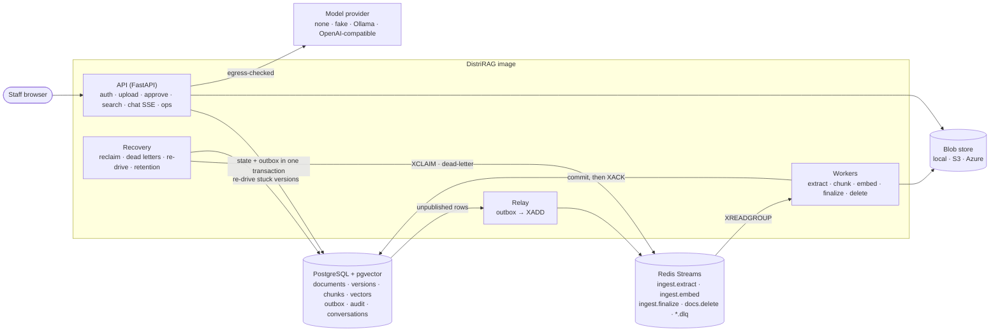

# Architecture

Postgres records every change first; Redis only carries the work. One Docker image runs every role
(`python -m run api|relay|worker|recovery|all`); the React app is built into it and served by the API.

In the `lite` profile every box inside the image runs in one process; in `full` each is its own container.

## How a document flows

1. **Upload** (doc-admins). The API validates the file (type by content, ≤ 10 MB), stores it, then in one transaction
   inserts the document, version (`PENDING_APPROVAL`), ACL and an audit entry. `Idempotency-Key` makes retries safe.
2. **Approve** (compliance, never the uploader). One transaction sets `QUEUED` and writes the outbox row
   `version.approved`.
3. **Relay** copies unpublished outbox rows to Redis with `XADD` and marks them published.
4. **Extract and chunk** (`ingest.extract`). Scanned, encrypted, malformed and empty files fail with a clear code and
   are not retried. Chunks (800 characters, 100 overlap, heading-aware) use `uuid5(version, index)` ids; one outbox
   row per batch of 16 is written in the same transaction.
5. **Embed** (`ingest.embed`). Each batch is embedded, upserted, and marked done; the transaction that completes the
   last batch writes `version.embedded`.
6. **Finalize** (`ingest.finalize`). One transaction checks every chunk has a vector, marks the previous version
   `SUPERSEDED` (unless a newer one is already live), points the document at this version, clears cached answers, and
   audits. Only now is the version searchable.
7. **Recovery.** Messages idle past `60 s × 2^(deliveries−1)` (capped at 10 minutes) are reclaimed by another worker;
   after 5 deliveries they move to a dead-letter stream and the version fails with `max_retries_exceeded`; versions
   stuck for 10 minutes with no pending message are re-driven from Postgres.

## How a question flows

PHI screen → classify (emergency, diagnosis request, patient-specific order, diagnostic support, clinical reference,
policy lookup, out of scope) → emergency banner → permission-filtered hybrid retrieval → refusal for diagnoses and
orders → egress policy by classification → prompt → generate (or passages only) → secret and PHI redaction → clinical
output check → citation verification → confidence score → receipt, conversation (redacted) and audit.

## Search

`score = (1 − w)·cosine + w·(share of meaningful query terms in the passage)`, with clinical abbreviation expansion.
Permission, approval and version filters are inside the SQL, so a restricted chunk, a pending draft or a superseded
version is never a candidate. At most two passages per document; results below `MIN_RELEVANCE` are hidden.
